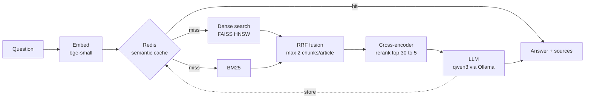

# RAG at Scale

End-to-end retrieval-augmented generation over news articles (CC-News):

- **Dynamic document chunking**: sentence-aware chunks sized in model tokens, with overlap, plus an
  optional semantic mode that also splits where the topic shifts
- **Hybrid search**: BM25 (lexical) + dense vectors (FAISS HNSW), fused with Reciprocal Rank Fusion
- **Cross-encoder reranking** of the fused candidates, for context precision
- **Semantic cache in Redis**: an exact-match layer, then vector search over past questions, which skips
  retrieval and the LLM on repeat or paraphrased questions. Because embeddings rate "eclipse in the
  Tri-Cities?" and "eclipse in Seattle?" as near-identical, a vector match must also pass a key-term guard
  and a duplicate-question cross-encoder before its cached answer is served
- **Evaluation suite** that measures every one of the above: [`eval/results.md`](eval/results.md)



## Results

5,000 CC-News articles, 250 generated questions plus 150 "hard" ones that avoid any names from the article.
Laptop CPU for embedding and reranking, qwen3 8B through Ollama.

| | Original (400-word chunks, dense only) | This pipeline |
|---|---|---|
| Chunks cut off at the embedding model's 512-token limit | 25.6% | **0%** |
| Hard questions: right article ranked 1st (R@1) | 64.7% | **79.3%** (semantic chunks) / 75.3% (dynamic) |
| Hard questions: MRR | 0.724 | **0.840** |
| Standard questions: R@1 / R@5 | 82.0% / 94.0% | **91.2% / 98.8%** |
| Source article among the passages the LLM sees | 92.5% | **100%** |
| Tokens per LLM call | 2,121 | **1,649 (-22%)** |

| Semantic cache | |
|---|---|
| Near-miss questions served a *wrong* cached answer | 76% with vector similarity alone → **0%** with key-term guard + verifier |
| Paraphrased questions served from cache | **92.7%** (95% in the end-to-end latency run) |
| p50 latency | miss 13.5 s (93% of it is the LLM) · exact hit **19 ms** · semantic hit **60 ms** |

At 1M vectors, FAISS HNSW answers in 0.59 ms vs 45 ms for exact search (77x) at 96.6% recall.

Full tables, method and caveats: [`eval/results.md`](eval/results.md).

## Setup

Requires Python 3.12+, [Ollama](https://ollama.com) and Docker (for Redis).

```powershell
python -m venv venv
venv\Scripts\Activate.ps1
pip install -r requirements.txt

ollama pull qwen3
docker run -d --name rag-redis -p 6379:6379 redis/redis-stack-server:latest
```

## Build the index

```powershell
python -m rag.ingest --n 5000            # download articles to data/articles.jsonl (resumable)
python -m rag.index --mode dynamic       # chunk + embed + FAISS + BM25 into data/index_dynamic
```

`--mode fixed` builds the original 400-word chunks and `--mode semantic` adds topic-shift breaks.
Semantic scored best on the hard questions but produces 65% more chunks and takes about 2.5x longer to build;
dynamic is the default. Each mode writes to its own `data/index_<mode>` folder (point the app at one with
`RAG_INDEX_DIR`). `--limit N` uses only the first N articles.
To grow the corpus, rerun ingest with a bigger `--n`: it continues where it stopped.

## Ask questions

```powershell
uvicorn app:app --port 8000              # interactive docs at http://localhost:8000/docs
```

```powershell
curl -X POST localhost:8000/query -H "Content-Type: application/json" -d '{\"question\": \"Who is leading New York City Ballet after Peter Martins?\"}'
```

| Endpoint | |
|---|---|
| `POST /query` | `{question, use_cache}` → `{answer, sources, cache_hit, cache, timings}` |
| `POST /query/stream` | the same, as newline-delimited JSON events: `sources`, `token`..., `done` |
| `GET /stats` | cache hits (exact / semantic), misses, hit rate, LLM tokens saved |
| `GET /health` | Redis, LLM and index status |
| `DELETE /cache` | clear the cache |

From Python: `from rag.pipeline import answer; answer("...")`.

Or run the API and Redis in containers (build the index on the host first):

```powershell
docker compose up --build
```

## Configuration

All settings live in [`rag/config.py`](rag/config.py). The main ones can be overridden with environment
variables: `RAG_INDEX_DIR`, `RAG_DENSE_BACKEND` (`faiss` or `numpy`), `RAG_RERANK_MODEL`,
`RAG_CACHE_THRESHOLD`, `RAG_CACHE_VERIFIER` (empty to turn it off), `OLLAMA_URL`, `LLM_MODEL`, `REDIS_URL`.

## Evaluate

```powershell
python -m eval.make_questions --n 250                 # eval set: LLM-written questions, one per article
python -m eval.make_questions --n 150 --style hard    # harder set: no names from the article
python -m eval.retrieval --index fixed                # R@k / MRR / nDCG for every retriever config
python -m eval.retrieval --index dynamic
python -m eval.retrieval --index semantic
python -m eval.retrieval --index dynamic --questions hard    # (and fixed / semantic)
python -m eval.ann --index dynamic                    # HNSW vs exact search, efSearch sweep
python -m eval.ann_scale                              # the same at 100k-1M vectors
python -m eval.cache_eval                             # tune the cache threshold, check it in Redis
python -m eval.quality                                # LLM-judged answers: original vs full pipeline
python -m eval.latency                                # per-stage p50/p95: cold, exact hit, semantic hit
python -m eval.report                                 # write eval/results.md
pytest
```

## Layout

```
rag/
  config.py      settings
  ingest.py      resumable CC-News download, removes syndicated duplicates
  chunking.py    fixed (baseline), dynamic and semantic chunkers
  embedding.py   bge-small-en-v1.5 query and passage embeddings
  store.py       chunk text and metadata in SQLite
  index.py       builds an index: chunks.db, embeddings.npy, dense.faiss, bm25/, meta.json
  dense.py       FAISS HNSW or exact NumPy search
  lexical.py     BM25 (bm25s, English stopwords + stemming)
  retrieve.py    dense, lexical, RRF and weighted fusion, per-article cap
  rerank.py      cross-encoder reranking
  cache.py       Redis semantic cache: exact match, vector candidates, key-term guard, verifier
  generate.py    prompt and Ollama chat (plain and streaming)
  pipeline.py    answer() and answer_stream(): the whole flow, timed per stage
app.py           FastAPI service
eval/            evaluation scripts, questions, results
tests/           pytest (cache tests skip when Redis isn't running)
```
